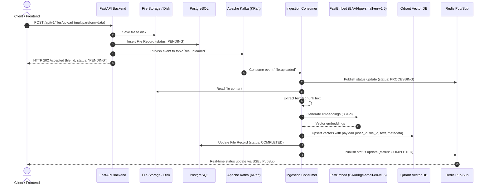
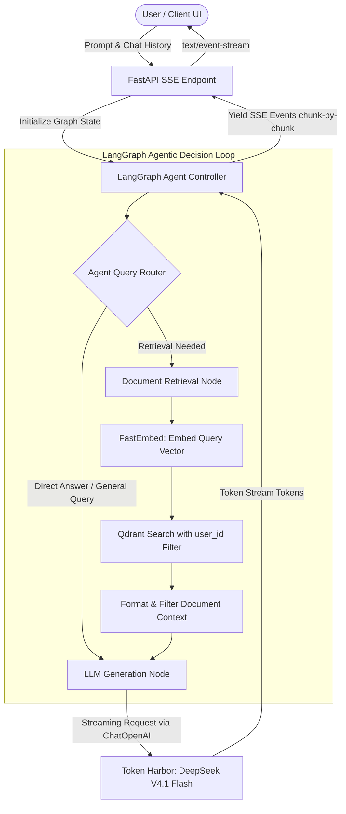

# KafMind 🧠⚡

KafMind is an enterprise-grade, ChatGPT-like **Agentic RAG** (Retrieval-Augmented Generation) application designed for high-speed document retrieval, autonomous agent reasoning, and scalable, asynchronous file ingestion powered by **Apache Kafka**.

---

## 🚀 Key Features

- **Asynchronous File Ingestion**: File uploads return `202 Accepted` immediately without blocking the client. File parsing, chunking, and vector indexing run asynchronously through event streams on Apache Kafka.
- **Agentic RAG Reasoning**: LangGraph orchestrates multi-step retrieval, query routing, source evaluation, and synthesis loops.
- **Streaming Responses**: Token-by-token real-time streaming directly to the client via Server-Sent Events (SSE).
- **Strict Multi-Tenant Isolation**: Every vector embedding payload stored in Qdrant is isolated with mandatory `user_id` filters.
- **Modern Responsive UI**: Built with React 19, TypeScript, TailwindCSS, and shadcn/ui for a fluid, ChatGPT-like conversation experience.

---

## 🛠️ Mandatory Tech Stack

| Layer | Technologies |
| :--- | :--- |
| **Frontend** | React 19 (Vite + TypeScript), TailwindCSS, shadcn/ui, Zustand, TanStack Query, `@microsoft/fetch-event-source` |
| **Backend API** | FastAPI (Python 3.12+), SQLAlchemy 2.0 (AsyncPG), Alembic, Pydantic v2 |
| **Event Streaming** | Apache Kafka (KRaft mode) + `aiokafka` (Async Producer & Consumer) |
| **AI & Agent Workflow**| LangChain & LangGraph |
| **LLM Inference** | Token Harbor (`deepseek-v4.1-flash:free`) via OpenAI-compatible SDK |
| **Vector Search** | Qdrant (`AsyncQdrantClient`) + FastEmbed (`BAAI/bge-small-en-v1.5`, 384-d) |
| **Relational DB & Cache** | PostgreSQL 16 (Users, Sessions, Messages, Files) + Redis 7 (JWT Blacklist & Pub/Sub) |

---

## 📐 System Architecture & Workflows

### 1. Asynchronous File Upload & Kafka Ingestion Pipeline
When a user uploads a document, FastAPI persists the raw file and initial metadata, emits an event to Kafka, and immediately responds to the client. The ingestion worker processes and embeds chunks asynchronously, reporting progress over Redis pub/sub.



---

### 2. Agentic RAG & SSE Streaming Flow with LangGraph
User questions flow through a LangGraph agent loop. The agent evaluates whether contextual retrieval is required, queries Qdrant with tenant-isolated filters, and streams tokens generated by DeepSeek V4.1 Flash via Server-Sent Events (SSE).



---

## ⚡ Quick-Start Instructions

### Prerequisites
- Docker & Docker Compose (v2.20+)
- *Optional for local dev:* Python 3.12+, Node.js 20+, Conda (`ml-env`)

---

### Option A: Complete Production Stack via Docker Compose (Recommended)
Run the entire platform (PostgreSQL, Redis, Qdrant, Apache Kafka, FastAPI Backend, Ingestion Worker, and Frontend) in a single command:

1. **Configure Environment:**
   ```bash
   cp .env.example .env
   # Edit .env and supply your TOKEN_HARBOR_API_KEY
   ```

2. **Launch All Services:**
   ```bash
   docker compose up --build -d
   ```

3. **Access Services:**
   - **Frontend UI:** [http://localhost:3000](http://localhost:3000)
   - **FastAPI Documentation:** [http://localhost:8000/docs](http://localhost:8000/docs)
   - **API Health Check:** [http://localhost:8000/api/v1/health](http://localhost:8000/api/v1/health)
   - **Qdrant Dashboard:** [http://localhost:6333/dashboard](http://localhost:6333/dashboard)

---

### Option B: Local Development Setup

1. **Environment Configuration:**
   ```bash
   cp .env.example .env
   ```

2. **Start Infrastructure Services:**
   ```bash
   docker compose up postgres redis qdrant kafka -d
   ```

3. **Backend API & Migrations:**
   ```bash
   conda activate ml-env
   cd backend
   pip install -r requirements.txt
   alembic upgrade head
   uvicorn app.main:app --host 0.0.0.0 --port 8000 --reload
   ```

4. **Kafka Ingestion Worker:**
   In a separate terminal:
   ```bash
   conda activate ml-env
   cd backend
   python -m app.workers.ingestion_worker
   ```

5. **Frontend Development Server:**
   ```bash
   cd frontend
   npm install
   npm run dev
   ```
   Open [http://localhost:5173](http://localhost:5173).

---

## 🧪 Verification & Automated Testing

### Backend Test Suite
The backend features an asynchronous test suite covering infrastructure health, authentication, asynchronous ingestion, LangGraph agent routing, SSE streaming, and multi-tenant end-to-end flows:
```bash
cd backend
pytest -v
```

### Frontend Test Suite
The frontend includes unit and component tests validating routing, authentication, state management, and SSE chat:
```bash
cd frontend
npm run test
```

---

## 🔒 Stage-Gate Protocol
Development follows strict stage gates outlined in [AGENTS.md](AGENTS.md). Each stage is completely self-contained and strictly verified before moving to the next.
